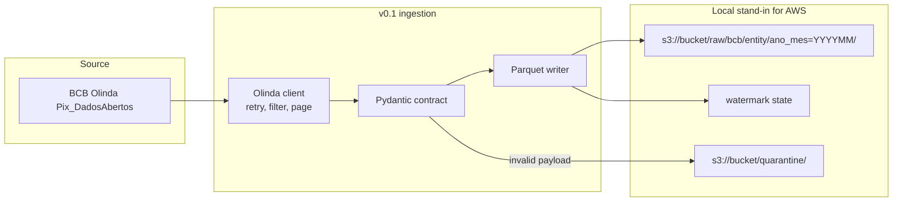
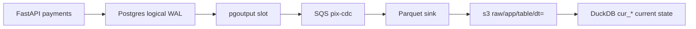
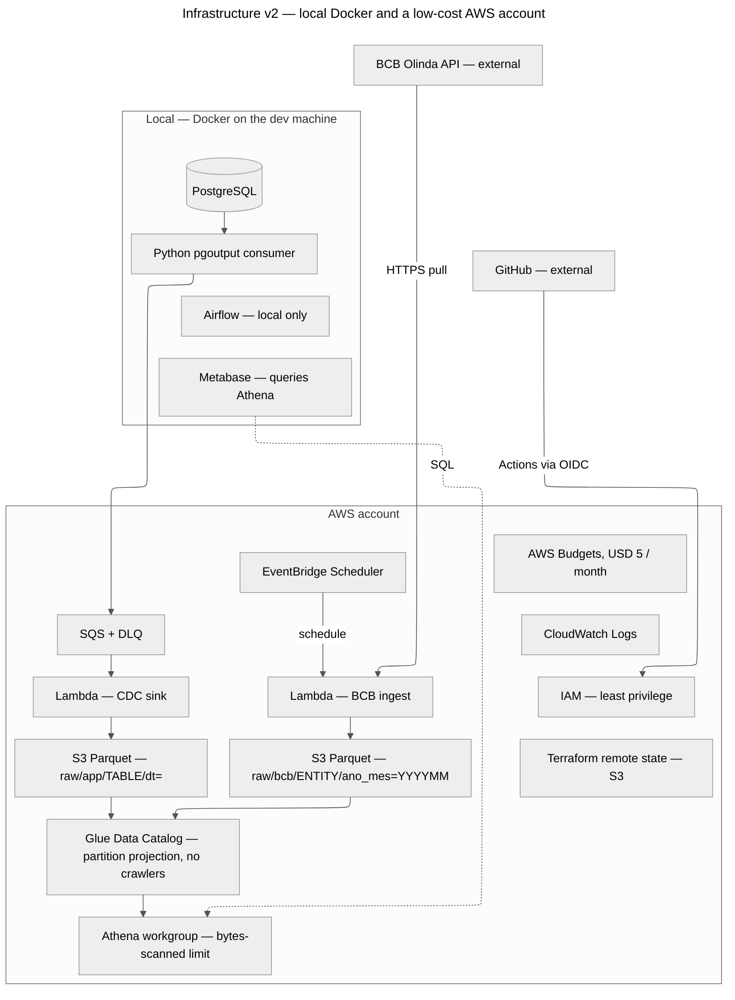
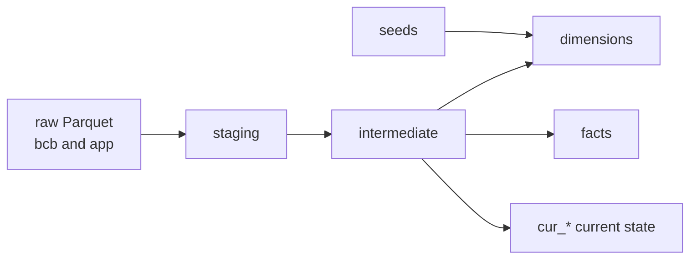
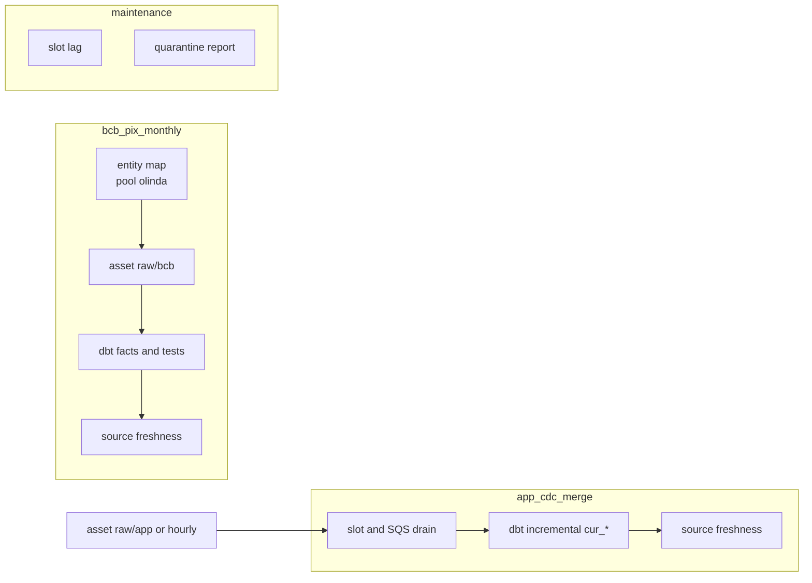

# pix-data-platform

Senior backend engineer and tech lead with 10+ years shipping production APIs in Python and Node. This repository is an end-to-end data platform I designed and built: public PIX payments data from Banco Central do Brasil lands in S3, is transformed and tested in dbt, orchestrated in Airflow, and explored in Metabase, with AWS infrastructure in Terraform. It applies production habits (idempotent ingestion, data tests, retries, freshness checks, infrastructure as code) to an analytical stack in the payments domain.

v0.1 is the ingestion slice: public PIX statistics from the BCB Olinda API land as Parquet partitions on S3. LocalStack stands in for S3 so the slice runs without an AWS account. v0.2 models that raw zone as a star schema in DuckDB. v0.3 adds a simulated PSP on Postgres and captures its changes with logical replication. v0.4 is the low-cost AWS account (S3, Lambda, SQS, Glue, Athena). v0.5 ports the warehouse to dbt. v0.6 runs Airflow in Docker on the laptop. Postgres, Airflow, and Metabase stay there. In AWS, EventBridge still invokes the Lambdas. There is no MWAA.



## How to run

```bash
python3 -m venv .venv
source .venv/bin/activate
pip install -e '.[dev]'
cp .env.example .env   # optional; the defaults match this compose file
make up && make ingest && make test
```

`make up` starts Postgres 16 (with `wal_level=logical`) and LocalStack S3 and SQS, waits until both are healthy, and creates the raw bucket. `make ingest` pulls the last three months from the live BCB API and overwrites those partitions. `make test` runs the unit suite and, when LocalStack is up, the S3 integration tests. The API tests run when Postgres answers on port 5432; CI starts a Postgres service for them. The logical-replication test runs only when `wal_level` is `logical`, so it skips in CI. The DuckDB model tests use fixture Parquet and do not need the network.

Other targets:

```bash
make lint
make down
make backfill START=202011 END=202012
python -m ingestion.bcb ingest --entities ChavesPix --lookback-months 3
PIX_RAW_SOURCE=s3 make model && make dq
make dbt-deps && make dbt-build && make dbt-docs
make airflow-up
make airflow-test
```

`make airflow-up` needs `pip install -e '.[dev,airflow]'`. It builds the Airflow 3.4 image and starts the `airflow` compose profile. `make airflow-test` does not start those containers. It imports the DAGs. The UI is on port 8080, and new DAGs are paused. The steps are in [docs/runbooks/airflow-local.md](docs/runbooks/airflow-local.md).

The Lambda-style entrypoint is `ingestion.bcb.handler.handler`. It reads the same environment variables and accepts `{"mode": "ingest"}` or `{"mode": "backfill", "start": 202011, "end": 202012}`.

## v0.1 scope

In this release:

- Python 3.12 project (`pyproject.toml`), Makefile, GitHub Actions (ruff + pytest), `.gitignore`, `.env.example`
- `docker-compose.yml` with Postgres and LocalStack S3
- Olinda client with retries, backoff, `$filter`, and `$top`/`$skip` pagination
- Pydantic contracts and a PyArrow Parquet writer for `EstatisticasTransacoesPix`, `TransacoesPixPorMunicipio`, and `ChavesPix`
- Incremental watermark in `s3://<bucket>/raw/bcb/_state/watermarks.json`, reprocessing the last N months (default 3) by overwriting whole partitions
- Backfill with `--start` and `--end`
- Quarantine of a payload that breaks the contract, under `s3://<bucket>/quarantine/<entity>/`
- Unit tests for the client, the watermark, and partition overwrite, plus a LocalStack integration test that skips when the endpoint is down

Not in v0.1: the warehouse, the payments app, CDC, Terraform, real AWS, dbt, Airflow, Metabase. The star schema is v0.2. The payments app and CDC are v0.3. Postgres is running so that slice has a database; ingestion does not connect to it.

The API behaves differently from a plain OData month parameter. Read [docs/spike-bcb.md](docs/spike-bcb.md) before changing the client. The local-first choice is recorded in [docs/adr/ADR-001.md](docs/adr/ADR-001.md).

## v0.2 scope

`make model` builds a local DuckDB file (`data/pix.duckdb`) from the raw Parquet. `make dq` runs the data-quality checks against that file. The default source is a local directory, `data/raw`, laid out like the bucket (`bcb/<entity>/ano_mes=YYYYMM/part.parquet`). After `make ingest` the files are in LocalStack, so point the build at S3:

```bash
PIX_RAW_SOURCE=s3 make model
make dq
```

DuckDB reads that bucket through httpfs. The first S3 build downloads the extension. An empty `AWS_ENDPOINT_URL` is real S3 and uses virtual-hosted addressing; a set endpoint (LocalStack) uses path-style HTTP. The same switch as the ingestion client.

The models were plain SQL, one file each, under `transform/sql/` in four layers: seeds, staging, intermediate, and marts. v0.5 keeps those files as the parity oracle. `make model` and `make dq` run dbt. Staging renames and types the Olinda columns. Intermediate keeps the monthly `N/D` municipality as `Não informado` (`municipio_ibge` 0) and derives the key-snapshot month. Marts are the star schema. Facts:

- `fct_transacoes_mensal`: one row per month and the published combination of person type, region, age band, initiation form, natureza, and finalidade. `valor` and `quantidade` add to the national month.
- `fct_transacoes_municipio`: one row per month and municipality, including `Não informado`. Value sent and value received are separate. Do not add them.
- `fct_chaves_pix`: one row per snapshot month, ISPB, person type, and key type. A stock of keys, not payment volume.

`dim_natureza` maps the nine raw codes and records where each label comes from. A code that is not in the seed is kept. Fraud is not modeled: it is not in the raw zone. Example questions (volume by month, top UFs and municipalities by value received, key-type mix) are in [docs/queries](docs/queries). There is no population in the extract, so those rankings are not per capita. The grain and the DuckDB choice are recorded in [docs/adr/ADR-002.md](docs/adr/ADR-002.md).

Tests build a small Parquet fixture with the ingestion writer and run the models and the checks locally. CI does not call Olinda or S3 for this slice. The LocalStack httpfs test skips when port 4566 is closed, same as the ingestion integration test.

## v0.3 scope

A simulated payment institution lives in the compose Postgres: a PIX key registry, the payments that institution sends and receives, and a small MED-style dispute table. `ispb` is 8 digits, `municipio_ibge` is the IBGE municipality code, and key types and initiation forms use the same literals as the v0.2 dimensions, so the operational rows can be joined to them.



`make api` applies the Alembic migrations and serves the API on port 8000 (`/health`, `/docs`, CRUD under `/keys`, `/transactions`, and `/disputes`). `make load` writes inserts, then updates, then deletes, one commit each. `make cdc` reads the `pgoutput` slot and publishes a JSON envelope (`op`, `table`, `pk`, `before`, `after`, `lsn`, `commit_ts`) to SQS. `make apply` writes those messages as Parquet at `raw/app/<table>/dt=YYYY-MM-DD/` and skips a repeat of the same commit LSN and primary key. `make model` builds `cur_pix_key`, `cur_pix_transaction`, and `cur_pix_dispute`: the latest image per id, with deletes removed.

A replication slot does not see rows that were committed before it existed. Start `make cdc` before `make load`, or use `make e2e`, which recreates the slot, resets the tables, loads, drains the queue, and checks the current-state tables against Postgres. `make e2e` needs `make up` first. Debezium is not in this slice. The tradeoff, the at-least-once path, and the WAL retention risk are in [docs/adr/ADR-003.md](docs/adr/ADR-003.md).

```bash
make up
make e2e
```

## v0.4 scope

Real S3 replaces LocalStack when `AWS_ENDPOINT_URL` is empty or `aws`. The account is the low-cost shape in [ADR-004](docs/adr/ADR-004.md): S3, two Lambdas, SQS, Glue partition projection, Athena, a USD 5 budget, and a GitHub OIDC deploy role. There is no EC2 instance, RDS database, load balancer, or NAT gateway. Postgres, the pgoutput consumer, Airflow, and Metabase stay on the laptop. Metabase is not installed here; the dotted SQL edge is the path a local Metabase uses to read Athena.



The dev root is `infra/terraform/envs/dev`. CI runs `terraform fmt`, `init -backend=false`, `validate`, tflint, and checkov. It does not apply. A manual workflow runs plan or apply only when the deploy role, state bucket, region, and budget email are set. Steps are in [docs/runbooks/aws-dev.md](docs/runbooks/aws-dev.md). The cost estimate is [docs/cost-estimate.md](docs/cost-estimate.md).

In this release:

- Data lake bucket with `raw/`, `curated/`, and `athena-results/`, SSE-S3, public access blocked, and lifecycle rules
- BCB ingest Lambda packaged from `ingestion/`, scheduled daily and monthly in `America/Sao_Paulo`
- SQS queue, dead-letter queue, and CDC sink Lambda. The event source mapping uses `ReportBatchItemFailures`
- Glue databases and external tables with partition projection, and no crawlers
- Athena workgroup with an enforced 1 GiB bytes-scanned cutoff
- Account-wide budget of USD 5. The inbox is `budget_alert_email`
- 14-day CloudWatch log retention and least-privilege IAM
- GitHub Actions OIDC provider and a deploy role scoped to this repository's deploy workflow
- Remote state in S3 with Terraform's native lockfile, plus a bootstrap root
- `transform/athena/views.sql`, Athena views generated from the DuckDB models

The default region is `us-east-1` because that is where the unit prices and the free tier are cheapest. `aws_region = "sa-east-1"` keeps the buckets in São Paulo. A quiet month should cost about zero dollars. Read the cost table before leaving a stack applied.

## v0.5 scope

`make model` is `dbt seed` and `dbt run`. `make dq` is `dbt test`. `make dbt-build` is `dbt build` (seeds, models, and tests). The default target is DuckDB (`dbt-duckdb`), reading the same raw Parquet zone as v0.2: a local directory, or S3 and LocalStack through httpfs when `PIX_RAW_SOURCE=s3`. An empty partition glob still builds. The seeded dimensions come up with zero fact rows.



Lineage is seeds and raw sources into staging, then intermediate, then marts. Staging renames and types. Intermediate keeps the `N/D` municipality, the key-snapshot month, and the latest CDC image per id (deletes included). Marts are the dimensions, the three facts, and `cur_pix_key`, `cur_pix_transaction`, and `cur_pix_dispute` with deletes removed. The current-state models are incremental on DuckDB: `delete+insert` on `id`, ordered by `lsn_ord`. A late file is applied only when its winning LSN is newer than the stored one. A winning delete is removed by a post-hook. Athena materializes those models as views, because the v0.4 catalog is Hive Parquet with partition projection, not Iceberg.

The `athena` target (`dbt-athena-community`) points at Glue database prefix `pix` and the workgroup Terraform names `pix-data-dev` (override with `PIX_ATHENA_WORKGROUP`, `PIX_ATHENA_STAGING_DIR`, `PIX_ATHENA_DATA_DIR`, `PIX_GLUE_PREFIX`). CI does not run it. `dbt parse --target athena` does not call AWS. A real deploy is `dbt build --target athena` in that workgroup, which replaces applying `transform/athena/views.sql` by hand. The script stays: it is still rendered from the legacy SQL and checked in CI, and there is no AWS account in CI to compile against Glue.

`schema.yml` describes every model and column. Generic tests cover unique keys, not-null columns, relationships, and the seed code lists. Singular tests cover the grain, the non-negative amounts, the `Não informado` municipality, one name per ISPB, and the current-state checks that are more than a single column. Source freshness uses the BCB partition month (the same checkpoint as the ingestion watermark) and `commit_ts` on the CDC logs. `dbt source freshness` is not part of CI. The Metabase dashboard is an exposure placeholder for v1.0. `make dbt-docs` writes the site under `transform/dbt/target`. `.github/workflows/dbt-docs.yml` publishes it to GitHub Pages when you run the workflow and Pages is enabled for Actions.

A parity test builds the legacy SQL warehouse and the dbt warehouse from the same fixture Parquet, including the CDC log, and compares the rows. `cur_*` may carry `lsn_ord` on the dbt side. That column is the merge key. The business columns match. The decision is in [docs/adr/ADR-005.md](docs/adr/ADR-005.md).

```bash
make dbt-deps
make dbt-build
make dbt-docs
```

## v0.6 scope

Airflow 3.4 runs in Docker, profile `airflow`, with LocalExecutor. The metadata database is a separate database on the compose Postgres. LocalStack is the S3 and SQS the tasks call. Nothing in this slice is MWAA or an Airflow service in the account. EventBridge and the two Lambdas are unchanged.



`bcb_pix_monthly` runs at 07:00 America/Sao_Paulo on the 2nd. One task per Olinda entity calls the existing ingestion pipeline. A scheduled run uses the watermark and the lookback window, and it overwrites partitions. `catchup` is off. A backfill is DAG conf `{"start":"202011","end":"202012"}` or `{"ano_mes":"202401"}`, or `airflow dags backfill`, which takes the logical month in America/Sao_Paulo. The Olinda pool is one slot. The task retries with exponential backoff after the client has already retried HTTP 500. Cosmos renders the dbt models upstream of the three facts, with tests, and a task runs `dbt source freshness`. The run publishes assets `s3://<bucket>/raw/bcb/` and `dbt://pix_data_platform/bcb_marts`.

`app_cdc_merge` runs at minute 15 every hour, or when `s3://<bucket>/raw/app/` is updated. It drains the logical slot to SQS and applies the queue, then builds the incremental `cur_*` models and checks CDC freshness. The drain does not emit `raw/app`, so the DAG does not schedule itself. It emits `dbt://pix_data_platform/cur_app`.

`maintenance` runs at 08:00 America/Sao_Paulo. It reports replication-slot lag and any object under `quarantine/`.

Failure callbacks log. `AIRFLOW_ALERT_SLACK_WEBHOOK_URL` also POSTs that line. Deadlines are measured from queue time, which is the Airflow 3 replacement for task SLAs. Pools, the Postgres connection, and the lag limit come from the environment. The runbook is [docs/runbooks/airflow-local.md](docs/runbooks/airflow-local.md). The decision is [docs/adr/ADR-006.md](docs/adr/ADR-006.md).

```bash
make airflow-up
make airflow-test
```

## Ingestion behavior

A run asks Olinda for each month in the window with `$filter`, validates every row, and writes one Parquet file per month:

`s3://<bucket>/raw/bcb/<entity>/ano_mes=YYYYMM/part.parquet`

The write deletes whatever is already under that prefix, so a second run replaces the partition. The same rows produce the same table. An empty response does not delete an existing partition: several series publish late, and an empty body must not wipe a good month.

The watermark is the newest **closed** month written for that entity. The calendar is America/Sao_Paulo. The current month is fetched when it falls inside the lookback window, and it is not stored as the watermark, because `TransacoesPixPorMunicipio` already contains the month before it closes. A watermark older than the window is caught up, including a revision of the previous N months. History before that window is a backfill, not a side effect of `make ingest`.

`NATUREZA`, `FORMAINICIACAO`, and the other classifications are stored as Olinda sent them. The loader does not invent display names.

If a row breaks the contract, that entity stops, the raw response is written to quarantine, the watermark stays where it was, and the other entities still run. The process exits non-zero.

## Roadmap

| Release | What lands |
| --- | --- |
| v0.1 | Foundation and incremental BCB PIX ingestion |
| v0.2 | Star schema in DuckDB over the raw Parquet |
| v0.3 | FastAPI + Postgres payments app, CDC via `pgoutput` |
| v0.4 | Low-cost serverless AWS. Postgres and Airflow stay in Docker |
| v0.5 | dbt models and tests on DuckDB, Athena target configured |
| v0.6 | This slice: Airflow in Docker. EventBridge stays the AWS schedule |
| v1.0 | Metabase and the final README |

## Layout

```text
orchestration/dags/            Airflow DAGs, local profile only
orchestration/                 ingest, CDC drain, freshness, alerts
ingestion/bcb/                 client, contracts, watermark, Parquet writer, CLI, handler
payments/                      FastAPI app, SQLAlchemy models, Alembic, load generator
cdc/                           pgoutput decoder, SQS publisher, Parquet sink, Lambda handler
transform/dbt/                 dbt project: models, seeds, tests, macros
transform/sql/                 legacy SQL runner, the parity oracle
transform/athena/views.sql     legacy Athena script, still checked, not the deploy path
docs/queries/                  example analytical questions
docs/spike-bcb.md              what the live Olinda service actually does
docs/adr/                      architecture decisions, including ADR-006
docs/architecture/             infrastructure diagram
docs/runbooks/                 deploy, destroy, and local Airflow
docs/cost-estimate.md          expected AWS bill
docs/career/                   positioning kit, not part of the pipeline
infra/terraform/               modules, bootstrap, and envs/dev
transform/athena/views.sql     Athena views generated from the models
tests/                         unit tests, fixture Parquet, LocalStack integration
```
