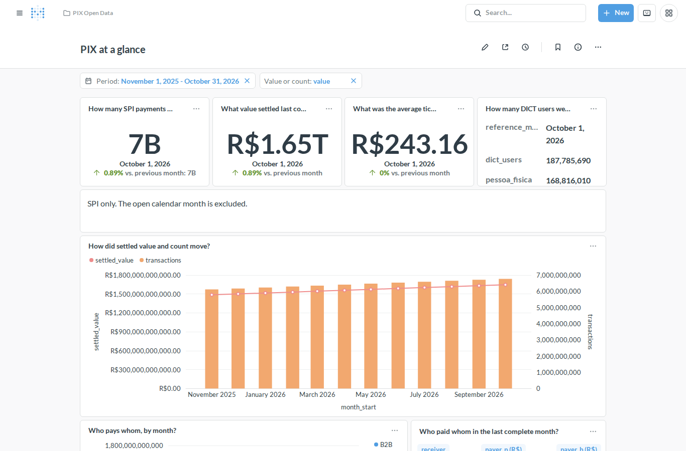
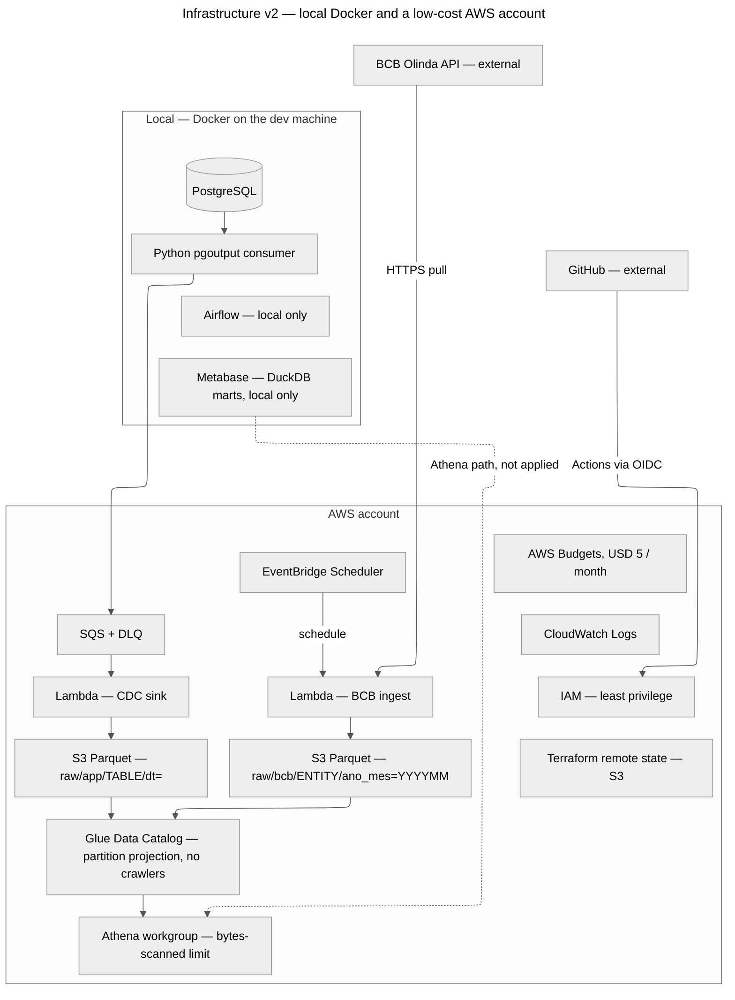

# pix-data-platform



Banco Central do Brasil publishes PIX statistics as separate Olinda feeds: national payments, municipalities, key stock, registered users, receiver profiles, and MED. None of them is a warehouse. A partial month is already in the file, MED arrives about a month late, and a payer total must not be added to a receiver total. This project lands those feeds as Parquet, models them in dbt, and serves three Metabase dashboards that keep those rules.

The screenshot is Metabase on this repo, profile `metabase`, after `make metabase-provision`. The numbers are a seeded extract shaped like the Olinda contracts, as of 25 November 2026. They are not a live download, and nothing in the picture is running in AWS.

## What this demonstrates

- Incremental ingestion of a public API, with watermarks, partition overwrite, and quarantine
- A dimensional model in dbt (DuckDB locally, an Athena target that is configured and not run)
- Data tests on grain, signs, and the joins a dashboard is not allowed to get wrong
- CDC from Postgres logical replication into the same lake
- Orchestration with Airflow 3.4 and Cosmos, local only
- A reproducible BI layer: dashboard SQL in git, created through the Metabase API
- Terraform for a small AWS account (S3, Lambda, SQS, Glue, Athena, a USD 5 budget). CI validates it. It has not been applied

## Architecture

Local Docker is what actually runs. The AWS account is the design in Terraform. The dotted line is the Athena path a later deploy would use. It has not been applied.



Source: [docs/architecture/infra-aws.mmd](docs/architecture/infra-aws.mmd).

## Quickstart

```bash
python3 -m venv .venv
source .venv/bin/activate
pip install -e '.[dev]'
make metabase-up
make metabase-provision
```

Open http://localhost:3000 and sign in as `pix@example.com` / `PixLocal-1a`. The collection is **PIX Open Data**.

| Dashboard | Question it answers |
| --- | --- |
| PIX at a glance | Volume, value, ticket, who pays whom, initiation mix, DICT users and key stock |
| Where it moves | Region, state and municipality, receiver by default |
| Receivers and MED | CNAE and firm size, then contested PIX via MED |

`make test` runs the unit suite. `make dbt-build` runs seeds, models and tests. `make airflow-up` is the local orchestrator and is a different compose profile. Steps for each are in [docs/runbooks](docs/runbooks).

## Release history

| Release | What landed |
| --- | --- |
| [v0.1](https://github.com/joaquim4lves/pix-data-platform/releases/tag/v0.1) | BCB PIX ingestion to Parquet |
| [v0.2](https://github.com/joaquim4lves/pix-data-platform/releases/tag/v0.2) | DuckDB star schema |
| [v0.3](https://github.com/joaquim4lves/pix-data-platform/releases/tag/v0.3) | FastAPI, Postgres, pgoutput CDC |
| [v0.4](https://github.com/joaquim4lves/pix-data-platform/releases/tag/v0.4) | Terraform for a small AWS account. Not applied |
| [v0.5](https://github.com/joaquim4lves/pix-data-platform/releases/tag/v0.5) | dbt on DuckDB, Athena target configured |
| [v0.6](https://github.com/joaquim4lves/pix-data-platform/releases/tag/v0.6) | Local Airflow 3.4 and Cosmos |
| v1.0 | Metabase dashboards and this README |

## ADRs

| ADR | Decision |
| --- | --- |
| [ADR-001](docs/adr/ADR-001.md) | Local-first ingestion, Olinda as it actually behaves |
| [ADR-002](docs/adr/ADR-002.md) | DuckDB star schema, SQL shared with Athena |
| [ADR-003](docs/adr/ADR-003.md) | pgoutput CDC, Postgres stays the system of record |
| [ADR-004](docs/adr/ADR-004.md) | Low-cost AWS, no NAT, no RDS, no always-on compute |
| [ADR-005](docs/adr/ADR-005.md) | dbt is the transformation layer |
| [ADR-006](docs/adr/ADR-006.md) | Airflow in Docker, not MWAA |
| [ADR-007](docs/adr/ADR-007.md) | Metabase on local DuckDB, definitions in git |
| [ADR-008](docs/adr/ADR-008.md) | Agentic development setup |

## Built with coding agents

Claude Code can drive this repository. Project memory, skills, hooks, and the feature ledger are described in [docs/agentic/README.md](docs/agentic/README.md). The decision is [ADR-008](docs/adr/ADR-008.md). Personal notes go in `CLAUDE.local.md`, which is gitignored.

## Cost

A quiet month of the Terraform design is about $0 while the AWS free tier lasts, and it should stay under $1 after that, if the account is dedicated to this stack and nobody adds a NAT gateway. The budget alarm is USD 5. The estimate is [docs/cost-estimate.md](docs/cost-estimate.md).

That bill is hypothetical. This repository has not been applied to AWS. Metabase and Airflow run in Docker and cost nothing on AWS because they are not in the account.

## Known limitations

- Terraform is validated in CI (`fmt`, `init -backend=false`, `validate`, tflint, checkov). It has not been applied. There is no S3 bucket, Lambda, or Athena workgroup in an account from this repo.
- Metabase reads DuckDB. The Athena edge is designed and unused.
- `make ingest` loads three Olinda entities. MED, CNAE receiver profile, and DICT users in the dashboards come from the seeded extract. The contracts are in the code. They are not on the live ingest path.
- Institution names on the key-stock table are sample names. The table is not a ranking of real participants, and it is not a ranking of payment volume.
- Municipality figures are not reconciled to the national SPI cube.
- There is no UF choropleth. The state chart is a ranked bar; a click sets the state filter.
- The payer-region to receiver-region view is a table for the last complete month, not a colored heatmap.
- Metabase cannot hide a card when a filter changes. Distinct people returns no rows unless one municipality is in the result. The age panel returns no rows when a state or municipality filter is set, and a note says the series is national.
- A chart with no rows shows Metabase's empty state. The question text says "No data for this period." A missing MED month is the sentence "October not published yet; last month is September 2026", not a zero.
- Precautionary-block panels are not in v1. `vlcompra`, `vldinespec` and `mesmatit` are not on the dashboards.
- The dashboard marts are not in `transform/athena/views.sql`. `dbt build --target athena` is still a manual step for the older models, and it has not been run against AWS.
- `make dbt-build` against a raw zone that lacks the seeded files replaces the MED, CNAE and DICT facts with empty tables. `METABASE_REBUILD=1 make metabase-provision`, with Metabase stopped, puts them back. See [docs/runbooks/metabase-local.md](docs/runbooks/metabase-local.md).
