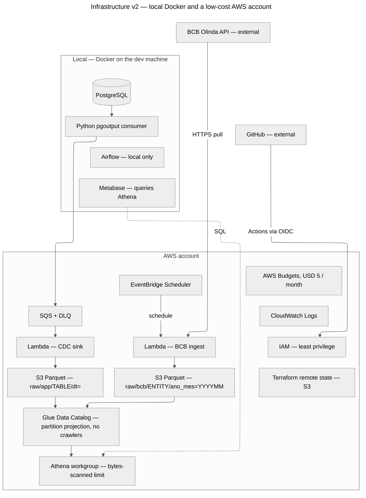

# ADR-004: Serverless, low-cost AWS for the PIX lake

- Status: accepted
- Date: 2026-11-24

## Context

v0.1 through v0.3 run on a laptop. LocalStack stands in for S3 and SQS. DuckDB reads the Parquet. Postgres is the operational database and the source of the `pgoutput` stream. v0.4 has to put the raw zone on real AWS without turning the portfolio into a bill.

The rejected shape is the one that looks like a production payments platform and costs money while it is idle: an EC2 instance or ECS service, RDS for Postgres, an application load balancer, and a NAT gateway so that private Lambdas can reach Olinda. A single NAT gateway is about $32 a month before data processing. RDS and a load balancer add more. That is the wrong default for a public dataset that is a few hundred megabytes and a consumer that runs on the same machine as the database.

The queries are the other cost. Athena charges $5 per TB scanned and has no free tier for bytes. A workgroup that does not cap a query can spend the whole monthly budget on one cross join. Glue crawlers charge per DPU-hour and still need a schedule. Partition projection does not.

## Decision

Deploy one dev account with Terraform, in `us-east-1` unless `aws_region` is set to `sa-east-1`. Postgres, the pgoutput consumer, Airflow, and Metabase stay in Docker. The AWS resources are the ones in the diagram.

### What runs where

- The BCB Lambda is `ingestion.bcb.handler.handler`. EventBridge Scheduler invokes it daily at 08:00 America/Sao_Paulo and again on the 2nd of the month. Both send `{"mode": "ingest"}`. The handler is idempotent: a partition overwrite of the lookback window is the revision mechanism from ADR-001. The function is not in a VPC. It calls Olinda over the public internet. `AWS_ENDPOINT_URL=aws` means real AWS. Lambda rejects an empty environment value, and the client treats `aws`, `none`, `off`, and an empty string the same way.
- The CDC path is local Postgres, the local consumer, then SQS, then the sink Lambda, then `raw/app/<table>/dt=YYYY-MM-DD/`. The event source mapping sets `ReportBatchItemFailures`, which is the `batchItemFailures` body the handler already returns. A dead-letter queue takes a message after three receives.
- Glue external tables use partition projection. There are no crawlers and no `MSCK REPAIR`. BCB partitions are an enum of real `YYYYMM` values from 202011 through 203512, because an integer range would also probe `202013`. App partitions are a date projection on `dt`, open-ended at `NOW`. Column types are generated from the Parquet writers (`columns.json`).
- The Athena workgroup enforces a 1 GiB bytes-scanned cutoff and writes results under `athena-results/`, encrypted, expired after 7 days. The account `primary` workgroup is not changed, so a query has to opt in.
- One account-wide budget of USD 5 emails `budget_alert_email` at 80 percent actual and 100 percent forecast. It is account-wide so a forgotten NAT gateway is visible. That assumes this account is dedicated to the portfolio.
- Log groups keep 14 days. The lake bucket uses SSE-S3, blocks public access, logs to a second bucket, versions objects, and expires noncurrent versions in 30 days. Current `raw/` and `curated/` objects are kept. `quarantine/` expires in 30 days.
- GitHub Actions assumes a deploy role with OIDC. The trust policy requires the `dev` environment claim, a subject for this repository, and `job_workflow_ref` on `.github/workflows/terraform-deploy.yml`. Pull-request tokens do not match. The role can manage this project's resources. It is not an administrator. Lambda execution roles can touch only their prefixes.
- Remote state is an S3 bucket from the bootstrap root, locked with Terraform's native lockfile (`use_lockfile = true`, Terraform 1.10 or newer). Bootstrap state stays local so the bucket can be created before anything stores state in it. A DynamoDB lock table is not created.

`transform/athena/views.sql` is the v0.2 and v0.3 model SQL with schema names prefixed (`pix_raw`, `pix_marts`, and the other layers). Terraform creates the databases and the raw tables. The views are applied by hand in the workgroup after the first objects exist. Metabase is not installed. The dotted SQL edge is that query path, drawn now so the warehouse has a reader that is not a second copy of the data.

### Region and cost

`us-east-1` is the default because S3, Lambda, and data-transfer list prices are lowest there, and the 12-month free tier is the one people actually get. Public BCB statistics have no residency requirement. The simulated CDC rows are not customer data. `sa-east-1` is a one-variable change when the buckets must sit in São Paulo. Unit prices there are higher. At this volume the monthly total still lands under the $5 budget. The numbers are in [docs/cost-estimate.md](../cost-estimate.md).

SSE-S3 is the encryption control. A customer-managed KMS key is about $1 a month plus request charges, which is a large fraction of the budget for a bucket this small. The same choice applies to log groups and to SQS, which uses the SQS-managed key.

## Alternatives considered

- EC2, ECS, RDS, an application load balancer, or Lambdas in a private subnet. Any of those adds an always-on charge. RDS would also move the system of record off the laptop, which ADR-003 kept in Postgres on purpose. The consumer is a few hundred lines of Python next to that database. Putting it on Fargate would mean a VPC.
- Default the region to `sa-east-1`. That is the right call for a production participant holding Brazilian customer data. It is the expensive call for this public extract. The variable is there.
- Glue crawlers, or `MSCK REPAIR TABLE` on a schedule. Crawlers cost money and can invent a column from a bad file. The writers already know the schema. Projection enumerates the partitions without a job.
- Integer projection on `ano_mes`. `YYYYMM` is not a continuous integer. A range from 202011 to 203512 includes thousands of values that are not months. The enum lists only valid months.
- A DynamoDB lock table. It works, and the free tier would cover one table. The native S3 lockfile is one less resource and one less IAM statement. The backend block is the place to switch back if a Terraform older than 1.10 has to be used.
- Customer-managed KMS for S3, logs, and Lambda environment variables. The environment values are a bucket name and the `aws` sentinel, not secrets. KMS would be the first line item that is not zero.
- An empty `AWS_ENDPOINT_URL` on the Lambda. The Lambda API rejects an empty environment value. The sentinel keeps ADR-001's switch working.
- Letting the deploy role be `AdministratorAccess`. It is shorter, and it can create the NAT gateway the budget is there to catch. The role is scoped to this project's names. The two actions that AWS does not scope (`iam:CreateOpenIDConnectProvider` and the event-source-mapping APIs) are called out in the policy.

## Consequences

- `terraform apply` is not run from CI, and it was not run to produce this change. There are no AWS credentials in the repository. `fmt`, `validate`, tflint, and checkov are the checks.
- A plan needs the zips from `infra/scripts/build_lambdas.sh`. Validate does not.
- The laptop that publishes CDC events needs `sqs:SendMessage` and `sqs:GetQueueUrl` on the queue, `AWS_ENDPOINT_URL` empty or `aws`, and no dummy access keys. The sink deletes the messages. `CDC_QUEUE` must be the Terraform output, not the LocalStack default `pix-cdc`.
- Lambda's execution role supplies temporary credentials. The clients forward `AWS_SESSION_TOKEN` and, when no keys are set, leave boto3 on its default chain. The old default of the dummy key `test` is only for a custom endpoint.
- The $5 budget is the alarm, not a hard stop. AWS Budgets does not kill resources unless a budget action is added, and this stack does not add one.
- An account that already has a GitHub OIDC provider must pass `existing_oidc_provider_arn`. AWS allows one provider per URL.
- The first apply uses an administrator. Later applies use the deploy role. If a provider release starts calling an API the role does not list, the plan fails with `AccessDenied` and the policy gains that action, still scoped to the project's ARNs.
- Extending the BCB partition enum past 203512 is a variable change (`bcb_ano_mes_end`), not a crawler.
- Athena views drift from `transform/sql` if `python -m transform.athena_sql` is not re-run. A unit test compares the committed script to the renderer.
- Destroy is `terraform destroy` in `envs/dev`, then, if the state bucket should go too, `terraform destroy` in `bootstrap`. Dev buckets set `force_destroy` so versions do not block the destroy. The state bucket does not.
