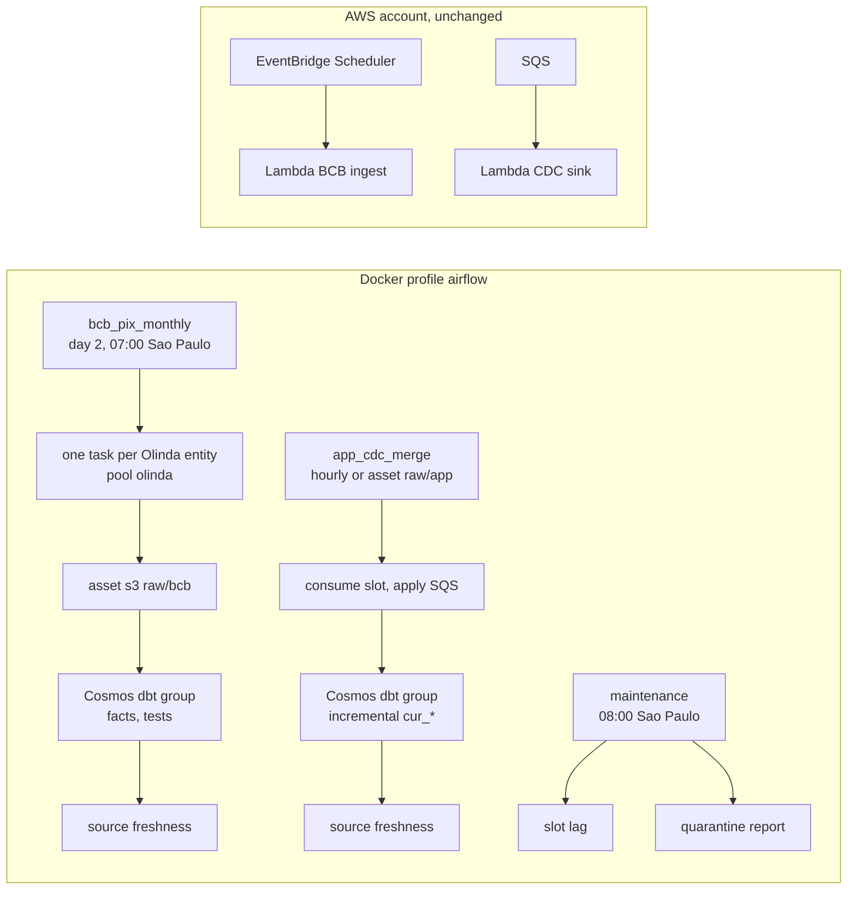

# Local Airflow

Airflow runs on the laptop, in the compose profile `airflow`. It does not run in AWS. EventBridge still invokes the BCB ingest Lambda, and SQS still invokes the CDC sink Lambda. MWAA is not in the account. The decision is [ADR-006](../adr/ADR-006.md).



## Start and stop

Postgres and LocalStack come up with the profile. `make up` does not start Airflow.

```bash
pip install -e '.[dev,airflow]'
# AIRFLOW_UID=$(id -u) belongs in .env so the container can write logs and DuckDB.
make airflow-up
```

The UI is `http://localhost:8080`. The user list is `admin:admin`. Simple auth writes a generated password to `/opt/airflow/simple_auth_manager_passwords.json.generated` inside the API server container and prints it in that container's log. DAGs are paused when they are first parsed. Unpause a DAG before expecting a run.

`make airflow-down` stops the API server, the scheduler, and the DAG processor. It leaves Postgres and LocalStack running. `make down` stops the whole project.

From inside the containers the database host is `postgres` and the S3 endpoint is `http://localstack:4566`. A `.env` on the host that says `localhost` is for processes on the host. The compose file sets the container hostnames itself.

Alerts go to the task log. Set `AIRFLOW_ALERT_SLACK_WEBHOOK_URL` to also POST a one-line message. The URL is not written into the message. The Fernet key and `AIRFLOW_JWT_SECRET` in `.env.example` are local placeholders for this stack.

## What each DAG does

`bcb_pix_monthly` runs at 07:00 America/Sao_Paulo on the 2nd. It maps `EstatisticasTransacoesPix`, `TransacoesPixPorMunicipio`, and `ChavesPix`. Each task calls the same pipeline as `make ingest` for that entity: watermark, lookback, overwrite of `ano_mes=YYYYMM`, no delete of an empty month. The Olinda pool has one slot (`OLINDA_POOL_SLOTS`). The task retries three times with exponential backoff after the client's own retries. The run then builds the dbt models upstream of the three facts, runs their tests, and checks BCB source freshness. The deadline is six hours from queue time.

`app_cdc_merge` runs at minute 15 every hour, or when asset `s3://<bucket>/raw/app/` is updated. It reads the logical slot once, publishes to SQS, and applies the queue to Parquet. It then builds `cur_pix_key`, `cur_pix_transaction`, and `cur_pix_dispute` and checks the CDC source freshness. The drain does not emit `raw/app`. Emitting that asset from this DAG would schedule the DAG again. Emit it from outside, or wait for the hour. The deadline is 45 minutes.

`maintenance` runs at 08:00 America/Sao_Paulo. It reads `pg_replication_slots` for `CDC_SLOT`. A missing slot is a log line. Lag above `CDC_SLOT_LAG_BYTES` (default 256 MiB, also read as `AIRFLOW_VAR_CDC_SLOT_LAG_BYTES`) fails the task. Any key under `quarantine/` fails the task. The deadline is 30 minutes.

dbt tasks share the `duckdb` pool, one slot. The file is `PIX_DUCKDB_PATH`. Do not run `make model` against that same file while a dbt task is running.

## Backfill and catchup

`catchup` is false. A normal scheduled run does not take its month from the logical date. It uses the watermark, which revises the last `LOOKBACK_MONTHS` (default 3). Enabling catchup does not walk history one month at a time.

One run, an inclusive YYYYMM range, still one task per entity:

```bash
docker compose --profile airflow run --rm airflow-scheduler \
  airflow dags trigger bcb_pix_monthly --conf '{"start":"202011","end":"202012"}'
```

One month:

```bash
docker compose --profile airflow run --rm airflow-scheduler \
  airflow dags trigger bcb_pix_monthly --conf '{"ano_mes":"202401"}'
```

Airflow's own backfill command sets the run type to `backfill`. Each logical date becomes one AnoMes in America/Sao_Paulo, and the task calls the backfill path for that month. Unpause the DAG first. This hits Olinda once per month per entity, through the pool:

```bash
docker compose --profile airflow run --rm airflow-scheduler \
  airflow dags backfill bcb_pix_monthly --start-date 2020-11-01 --end-date 2020-12-02
```

A conf window is the better way to load a range: one DAG run, the pipeline's own month loop, the same idempotent partition overwrite. `dags backfill` is the way to get one Airflow run per month.

Partitions that already exist are replaced with the same rows. An empty Olinda response does not delete a partition. A contract failure quarantines that entity, leaves its watermark, and fails the task. The other entities in the map still run.

## Asset edges

| Asset | Updated by | Can start |
| --- | --- | --- |
| `s3://<bucket>/raw/bcb/` | `publish_raw_bcb` | a later consumer. Nothing in this slice schedules on it |
| `dbt://pix_data_platform/bcb_marts` | BCB source freshness | a later consumer |
| `s3://<bucket>/raw/app/` | outside this DAG | `app_cdc_merge`, together with the hourly timetable |
| `dbt://pix_data_platform/cur_app` | CDC source freshness | a later consumer |

`<bucket>` is `S3_BUCKET`, default `pix-data-local`.

## Tests

`make airflow-test` imports Airflow and Cosmos and runs the callable tests plus the DAG import tests. It does not start compose. The import tests check that the three DAGs load, that the graphs have no cycles, and that tags, owner, retries, the Olinda pool, and the deadlines are set. `airflow dags test` is not part of CI. It executes the tasks.

## Pools and variables

`airflow-init` creates pool `olinda` and pool `duckdb`. Change the slot counts with `OLINDA_POOL_SLOTS` and `DUCKDB_POOL_SLOTS` and run the init service again.

`AIRFLOW_CONN_PIX_POSTGRES` points at the application database. The maintenance task reads `POSTGRES_*` through the same settings module as the CDC consumer. It does not embed a password.
