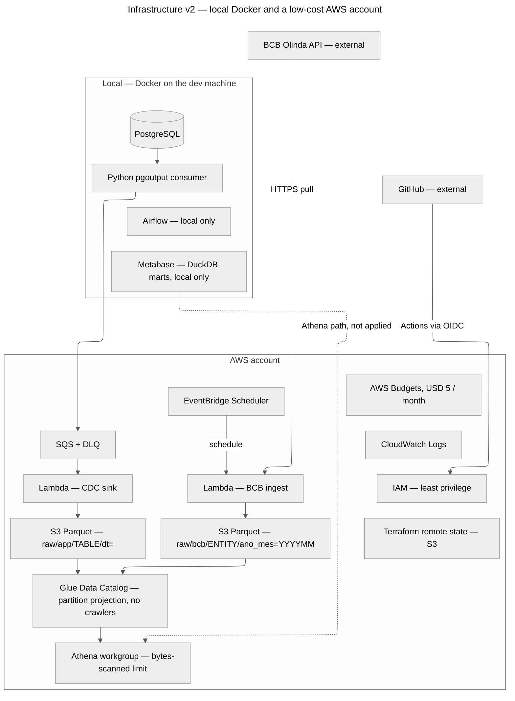

# Deploy and destroy the dev account

The stack is `infra/terraform`. It does not create an EC2 instance, an RDS database, a load balancer, or a NAT gateway. Postgres, the pgoutput consumer, Airflow, and Metabase stay in Docker. Airflow is the compose profile in [airflow-local.md](airflow-local.md), not MWAA. Metabase is not installed by this runbook. The dotted edge is the Athena path a local Metabase would use. It has not been applied. v1.0 Metabase reads DuckDB. See [metabase-local.md](metabase-local.md).



Nothing below runs `terraform apply` for you. CI only formats, initialises without a backend, validates, and lints. Do not apply until the budget email is an inbox you read.

## Cost

Read [docs/cost-estimate.md](../cost-estimate.md) first. The default region is `us-east-1`. Use `sa-east-1` only when the buckets must be in São Paulo. The budget is USD 5 a month for the whole account.

## One-time AWS setup

1. Use an account that does not already host something you need to keep. The budget is account-wide.
2. Install Terraform 1.10 or newer, the AWS CLI, and Python 3.12. The lockfile backend needs 1.10.
3. Bootstrap the state bucket with an administrator principal. Pick a globally unique name.

```bash
cd infra/terraform/bootstrap
cp terraform.tfvars.example terraform.tfvars
# edit bucket_name
terraform init
terraform apply
terraform output -raw bucket_arn
```

Bootstrap state is the local file `terraform.tfstate`. It is gitignored. Keep it. Losing it means importing the buckets before they can be destroyed.

The dev backend uses that bucket and Terraform's S3 lockfile (`use_lockfile = true`). There is no DynamoDB table. To use a DynamoDB lock instead, create the table yourself, set `use_lockfile = false`, and add `dynamodb_table` to the backend block.

4. Copy `infra/terraform/envs/dev/terraform.tfvars.example` to `terraform.tfvars` (gitignored). Set `budget_alert_email` and `state_bucket_arn` from the bootstrap output. Leave `aws_region` as `us-east-1` unless you chose São Paulo for the state bucket too. The two regions should match.

## Build the Lambda zips

`plan` reads the zip files. `validate` does not.

```bash
bash infra/scripts/build_lambdas.sh
```

The script vendors PyArrow 17, httpx, and pydantic for the Amazon Linux x86_64 runtime and omits boto3, which the Lambda runtime provides. A build of that script produced zips of about 57–60 MB, around 190 MB unzipped: over Lambda's 50 MB direct-upload limit and under the 250 MB unzipped limit, which is why Terraform uploads them to `artifacts/` in the lake bucket. The zips land in `infra/build/` and are not committed.

## Plan and apply

From `infra/terraform/envs/dev`, with the same administrator as bootstrap for the first apply:

```bash
cp backend.hcl.example backend.hcl
# edit bucket and region
terraform init -backend-config=backend.hcl
```

`backend.hcl` is gitignored. Or pass the flags:

```bash
terraform init \
  -backend-config="bucket=STATE_BUCKET" \
  -backend-config="region=us-east-1" \
  -backend-config="use_lockfile=true" \
  -backend-config="encrypt=true"

terraform plan
terraform apply
```

Save `github_deploy_role_arn`, `bucket_name`, `cdc_queue_name`, and `athena_workgroup` from the outputs.

If the account already has a GitHub OIDC provider for `token.actions.githubusercontent.com`, set `existing_oidc_provider_arn` and apply again. AWS allows one provider per URL.

## Let GitHub plan the next change

Repository variables, not secrets, except the inbox:

| Name | Kind | Value |
| --- | --- | --- |
| `AWS_DEPLOY_ROLE_ARN` | variable | output `github_deploy_role_arn` |
| `TF_STATE_BUCKET` | variable | state bucket name |
| `AWS_REGION` | variable | `us-east-1` or `sa-east-1` |
| `BUDGET_ALERT_EMAIL` | secret | same inbox as `budget_alert_email` |

Create a GitHub environment named `dev`. The OIDC subject and the `environment` claim must match it. Protect that environment with a required reviewer if more than one person can dispatch workflows. The workflow is `.github/workflows/terraform-deploy.yml`. It does nothing when those values are empty. `apply` runs only from `main`. `plan` can run from another branch.

The role trusts this repository's deploy workflow, not pull-request tokens. Confirm the subject in CloudTrail (`AssumeRoleWithWebIdentity`) if the first plan is denied. A repository that customised the OIDC subject to the environment form is still covered. A subject outside this repository is not.

## Point the laptop at the account

In `.env`, for a real account:

```bash
AWS_ENDPOINT_URL=aws
# or leave it empty. Do not leave it on http://localhost:4566
S3_BUCKET=<bucket_name output>
AWS_DEFAULT_REGION=us-east-1
CDC_QUEUE=<cdc_queue_name output>
```

Unset `AWS_ACCESS_KEY_ID` and `AWS_SECRET_ACCESS_KEY`. The dummy value `test` is only for LocalStack. A named profile or SSO then works, and a Lambda uses its session token. The principal that runs `make cdc` needs `sqs:GetQueueUrl` and `sqs:SendMessage` on the CDC queue. It does not need S3. The sink writes the Parquet.

`make ingest` from the laptop also works against the bucket if that principal can write `raw/bcb/` and `quarantine/`. The schedule does the same write from the Lambda. Do not run both against the same month at the same time if you care which watermark timestamp wins. Both overwrite the partition with the same rows.

## Views and a query

After the first ingest has written at least one partition:

```bash
python -m transform.athena_sql   # refreshes transform/athena/views.sql
```

Run that file in the workgroup from the output (the engine is Athena v3). Then:

```sql
SELECT "AnoMes", count(*) AS rows
FROM pix_raw.estatisticas_transacoes_pix
WHERE ano_mes = '202610'
GROUP BY 1
```

`ano_mes` is a string partition. Filtering it keeps Athena from listing every projected month. The bytes-scanned cutoff rejects a query over 1 GiB. Results expire after 7 days under `athena-results/`.

The national-volume question, once the views exist:

```sql
SELECT ano_mes, sum(valor) AS valor, sum(quantidade) AS quantidade
FROM pix_marts.fct_transacoes_mensal
GROUP BY ano_mes
ORDER BY ano_mes
```

A local Metabase, when it exists, uses this workgroup. This slice does not start it. `make model` still builds the DuckDB file and does not need Athena.

## Destroy

Order matters. The dev stack must go before the state bucket, because the dev state lives in that bucket.

```bash
cd infra/terraform/envs/dev
terraform destroy
```

Dev buckets are `force_destroy`, so object versions do not block this. Then, only if the state bucket should disappear:

```bash
cd infra/terraform/bootstrap
terraform destroy
```

The state bucket is not `force_destroy` unless you set the variable. Empty it on purpose. Destroying bootstrap does not delete the GitHub variables. Remove those yourself.

## What CI does

On every push and pull request, the terraform job runs:

```bash
terraform fmt -check -recursive
terraform -chdir=infra/terraform/bootstrap init -backend=false
terraform -chdir=infra/terraform/bootstrap validate
terraform -chdir=infra/terraform/envs/dev init -backend=false
terraform -chdir=infra/terraform/envs/dev validate
tflint --recursive
checkov -d infra/terraform --framework terraform
```

`make tf-check` is the fmt and validate half. No credentials, no apply.

## When something fails

- **Lambda cannot call S3 and the error mentions `localhost` or `test`.** `AWS_ENDPOINT_URL` is unset inside the function, so the client fell back to LocalStack, or dummy keys were copied into the environment. The function must have `AWS_ENDPOINT_URL=aws` and must not set access keys.
- **`InvalidClientTokenId` or a signature error from Lambda.** The session token was dropped. The clients forward `AWS_SESSION_TOKEN`. An older build of the zip does not.
- **Athena says the cutoff was exceeded.** The workgroup did what it is for. Add a partition filter before raising `athena_bytes_scanned_cutoff`.
- **`cdc` queue stays empty.** The consumer is still on LocalStack, or `CDC_QUEUE` is still `pix-cdc`.
- **OIDC `AccessDenied`.** The workflow must declare `environment: dev`, and the token's `job_workflow_ref` must be the deploy workflow in this repository.
- **Budget mail never arrives.** Confirm the subscription from the AWS mail, and give Billing a day to show spend. The budget does not stop resources.
